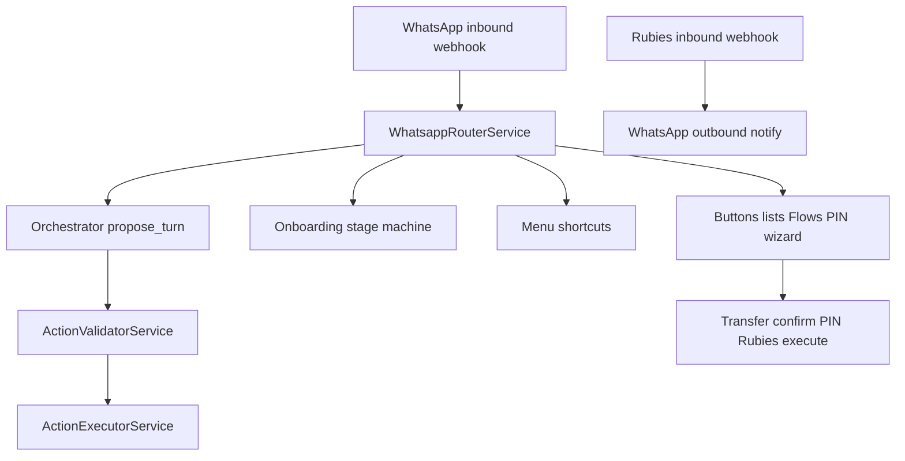
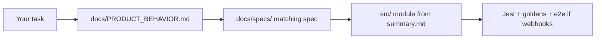

# Udara Codebase Briefing

## What the product is

**Udara** (user-facing name; npm package is still `kedu`) is a **WhatsApp savings agent**, not a general chatbot. It helps users manage money they keep in a **Rubies microfinance wallet** by enforcing:

- A **daily spending window** (WAT, default 11:00–20:00) — you cannot override this in chat
- **Daily/weekly allowances** with fee rules for early access or borrowing against future allowance
- **Confirm → PIN → execute** for every outbound transfer
- **KYC and PIN setup** only through WhatsApp Flows (never raw chat text for BVN/NIN/PIN)
- A **“managers” persona** for settings changes, with a minimum wait period before review

The core product idea: Udara’s value is in **holding users to their stated limits**, not in doing everything they ask. It is deliberately strict about spending discipline.

**Important doc gap:** The original PRD, onboarding script, and tone PDF are **not in the repo**. Treat **code + tests + [docs/](docs/README.md)** as source of truth.

---

## Tech stack

| Layer     | Choice                                                             |
| --------- | ------------------------------------------------------------------ |
| Backend   | NestJS 10 (Express), TypeScript                                    |
| Database  | PostgreSQL 16 via Prisma 5 (local host port **5433**)              |
| Messaging | WhatsApp Cloud API                                                 |
| Banking   | Rubies BaaS (wallet, transfers, name enquiry)                      |
| AI        | Pluggable LLM (`stub` default for local dev)                       |
| Tests     | Jest unit tests, golden orchestrator dialogues, black-box HTTP e2e |
| HTTP      | Default port **3000**                                              |

Local dev should keep dry-run flags on: `WHATSAPP_DRY_RUN=true`, `RUBIES_DRY_RUN=true`, `AI_PROVIDER=stub`.

Setup: [README.md](README.md) and [docs/DEVELOPMENT.md](docs/DEVELOPMENT.md).

---

## How a message flows through the system

**Routing rule of thumb** ([docs/PRODUCT_BEHAVIOR.md](docs/PRODUCT_BEHAVIOR.md)):

| Inbound type                       | Handler                             |
| ---------------------------------- | ----------------------------------- |
| Buttons, lists, Flow replies       | Deterministic code                  |
| Pre-account free text              | Onboarding stage machine            |
| Menu shortcuts (`menu`, `help`, …) | Main menu, no LLM                   |
| Post-onboarding free text          | Orchestrator → validator → executor |

**Critical safety model:**

- The **LLM proposes** actions via `propose_turn`; the **validator disposes**
- The model **never executes transfers** or invents balances
- **Surfaces own numbers** — balance, allowance, account details come from deterministic surfaces, not model memory
- No regex path extracts transfer details from free text

---

## Module map (where things live)

| Module          | Path                                                       | Responsibility                                                      |
| --------------- | ---------------------------------------------------------- | ------------------------------------------------------------------- |
| WhatsApp        | `[src/whatsapp/](src/whatsapp/)`                           | Webhook, router, transfer wizard, PIN gate, `ActionExecutorService` |
| Orchestrator    | `[src/orchestrator/](src/orchestrator/)`                   | AI turn brain, validator, surface registry — **no WhatsApp send**   |
| AI              | `[src/ai/](src/ai/)`                                       | LLM providers + persona/onboarding prompts                          |
| Onboarding      | `[src/onboarding/](src/onboarding/)`                       | Multi-stage onboarding machine                                      |
| Allowance       | `[src/allowance/](src/allowance/)`                         | Spending window, fees, daily/weekly allowance                       |
| Rubies          | `[src/rubies/](src/rubies/)`                               | BaaS client + inbound credit webhook                                |
| PIN             | `[src/pin/](src/pin/)`                                     | PIN challenge / verify                                              |
| Manager         | `[src/manager/](src/manager/)`                             | Settings-change gate + delayed “manager” persona                    |
| Tagging         | `[src/tagging/](src/tagging/)`                             | Recipient labels (RENT, FOOD, VENDOR, OTHER)                        |
| Prisma / Config | `[src/prisma/](src/prisma/)`, `[src/config/](src/config/)` | DB access, env validation                                           |
| CLI             | `[src/cli/](src/cli/)`                                     | Orchestrator dry-run + golden dialogue runner                       |

Full map: [.cursor/project/summary.md](.cursor/project/summary.md) and [docs/ARCHITECTURE.md](docs/ARCHITECTURE.md).

---

## Key product flows you should know

### 1. Onboarding (pre-account)

Stage sequence in Prisma (`[prisma/schema.prisma](prisma/schema.prisma)`):

`DISCOVERY` → `WELCOME` → `IDENTITY` → `FREQUENCY_CHECK` → `PLAN_PROPOSED` (KYC) → `MONEY_STORY` → `AI_REFLECTION` → `STRUCTURED_QUESTIONS` → `PLAN_REVIEW` → `ACCOUNT_CREATED` → `FUNDED` → `FIRST_TRANSACTION` → `COMPLETE`

KYC uses WhatsApp Flow JSON in [docs/whatsapp-flows/](docs/whatsapp-flows/).

### 2. Sending money (post-onboarding)

Two separate state machines — do not confuse them:

- `**TransferDraft`** — deterministic send-money wizard: amount → account → bank → label (new recipients)
- `**ConversationSession**` — AI chat history for Udara (`KEDU`) and manager personas

Transfer path:

1. User intent (free text may start/fill wizard via orchestrator surfaces)
2. Confirm buttons
3. PIN via WhatsApp Flow (`PENDING_PIN` status)
4. Rubies execute

Fee types: `NORMAL` (in window, within allowance), `EARLY_ACCESS` (outside window), `BORROWED` (against future allowance).

### 3. Orchestrator surfaces

Deterministic UI/actions the model can request (numbers rendered by code):

- `balance_read`, `limits_read`, `account_details`
- `transfer_wizard`, `spending_menu`, `spend_summary`

---

## Data model highlights

Core Prisma models (`[prisma/schema.prisma](prisma/schema.prisma)`):

- `User`, `DailyAllowance`, `Recipient`, `Transaction`
- `TransferDraft` (wizard state)
- `ConversationSession` (chat history)
- `OnboardingSession`, `WhatsappMessage`
- `SettingsChangeRequest`, PIN challenges, webhook logs, LLM call logs

Transaction statuses include `PENDING_CONFIRMATION` → `PENDING_PIN` → `EXECUTED`.

---

## Active work in flight

Two initiatives are **in progress** ([initiatives/README.md](initiatives/README.md)):

### [spend-check-before-send](initiatives/spend-check-before-send/plan.md)

**Problem:** Vague sends (e.g. “send 800 to opay”) jump straight into the transfer wizard when allowance remains. Product wants **one coaching question** about purpose first.

**Touches:** orchestrator prompt, `ActionValidatorService`, session `contextData.spendCheck`, goldens.

### [transfer-intent-grounding](initiatives/transfer-intent-grounding/plan.md)

**Problem:** After a successful send, follow-up messages like “thank you” or “you already sent it” were relaunching the transfer wizard.

**Touches:** utterance classifiers, validator gating, post-execute chat history injection, draft cancellation. Mostly implemented; landing/verification still in progress.

If your tasks relate to orchestrator behavior or transfers, start with the matching spec in [docs/specs/](docs/specs/README.md) and tech design in [docs/tech-design/](docs/tech-design/).

---

## How work is organized in this repo

Three-layer documentation for non-trivial changes:

1. **Initiative plan** — `initiatives/<slug>/plan.md` (execution status)
2. **Spec** — `docs/specs/` (observable behavior)
3. **Tech design** — `docs/tech-design/` (implementation)

Before editing, read [AGENTS.md](AGENTS.md). Hard constraints there are non-negotiable (PIN/KYC via Flows, confirm-then-PIN, surfaces own numbers, etc.).

---

## Commands you will use

| Command                             | Purpose                                  |
| ----------------------------------- | ---------------------------------------- |
| `npm run start:dev`                 | Run the Nest server                      |
| `npm test`                          | Unit tests                               |
| `npx jest <path>`                   | Targeted unit test for touched files     |
| `npm run orchestrator:golden`       | Validate orchestrator golden dialogues   |
| `npm run e2e` / `npm run e2e:smoke` | HTTP black-box scenarios                 |
| `npm run docs:check`                | Docs structure/link check (CI runs this) |

---

## Practical orientation for new tasks

| If your task involves…               | Start here                                                                 |
| ------------------------------------ | -------------------------------------------------------------------------- |
| WhatsApp routing, wizards, PIN       | `[src/whatsapp/](src/whatsapp/)`                                           |
| LLM turns, transfer intent, surfaces | `[src/orchestrator/](src/orchestrator/)`                                   |
| Onboarding stages / prompts          | `[src/onboarding/](src/onboarding/)`, `[src/ai/prompts/](src/ai/prompts/)` |
| Allowance, window, fees              | `[src/allowance/](src/allowance/)`                                         |
| Actual money movement                | `[src/rubies/](src/rubies/)`, transfer confirmation in whatsapp module     |
| Schema / migrations                  | `[prisma/schema.prisma](prisma/schema.prisma)`                             |
| In-progress features                 | [initiatives/](initiatives/README.md)                                      |

---

## Gotchas worth knowing early

- Postgres runs on host port **5433**, not 5432
- Package name `kedu` vs product name**Udara**
- `TransferDraft` ≠ `ConversationSession`
- Stub AI does not emit real `propose_turn` — e2e free-text paths need special handling
- CI runs lint, prisma, build, unit tests, docs:check — **not** e2e or live LLM
- Missing PRD/onboarding script — do not invent product behavior from memory

