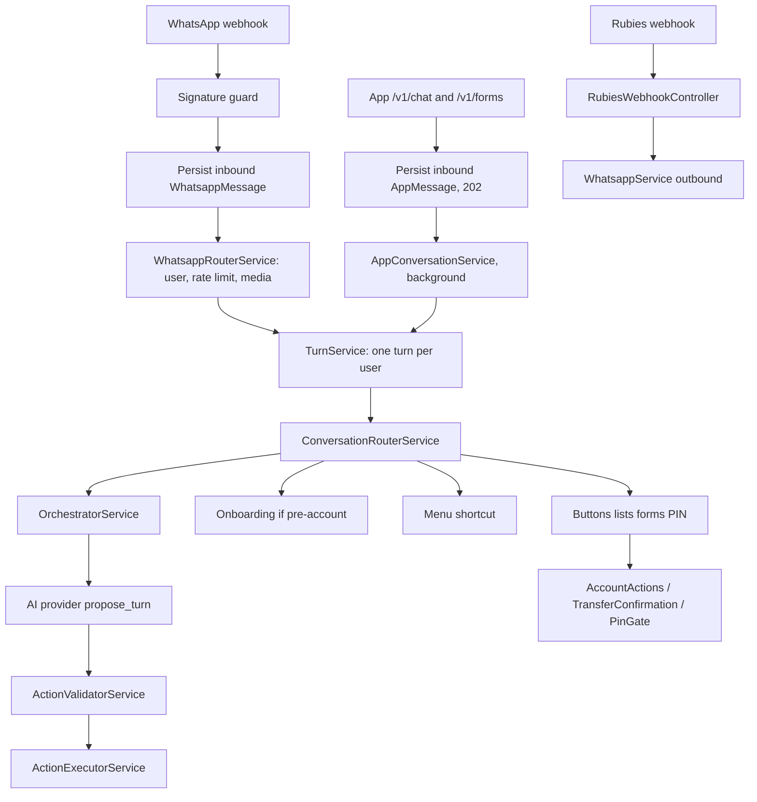

# Architecture

How inbound events become outbound WhatsApp messages and database writes.

## Stack

| Concern | Choice |
| --- | --- |
| Framework | NestJS 10 (Express), `rawBody: true` |
| Language | TypeScript (`strictNullChecks`, `noImplicitAny`) |
| Database | PostgreSQL 16 via Prisma 5 |
| HTTP | Controllers under `whatsapp/` and `rubies/` |
| LLM | Pluggable `AI_PROVIDER` (stub default); Gemini/Anthropic may receive one image per turn |
| Speech-to-text | Deepgram listen (`DEEPGRAM_API_KEY`); no TTS |
| Time | WAT helpers in `src/common/wat-time.util.ts` |
| Default port | 3000 |

## Repository layout

```
src/
  main.ts / app.module.ts
  health/          GET /health — database reachability
  prisma/          Global PrismaService
  config/          env.validation.ts
  allowance/       WindowService, FeeCalculator, AllowanceService, schedulers
  onboarding/      Stage machine
  tagging/         Recipient tags
  manager/         SettingsChangeRequest gate + delayed conversation
  rubies/          RubiesService + webhook controller
  ai/              Provider clients + persona/onboarding prompts
  orchestrator/    OrchestratorService, ActionValidator, surface registry, evals
  messaging/       ChannelMessenger (the only way to send), channel context, WhatsApp and app adapters, app message store
  conversation/    ConversationRouterService (what a message does, either channel), TurnService (one turn per user)
  app-auth/        App sign-in: SMS codes, sessions, new-device step-up and cap (always loaded)
  app-api/         Mobile app HTTP API under /v1 (loaded only when APP_API_ENABLED=true): auth, me, chat, forms, devices, the read-only screens (balance, limits, account, history, recipients, banks, name enquiry, spend summary, bill catalog, app config), and native transfers
  whatsapp/        Webhook, WhatsApp router, wizards, PIN gate, ActionExecutor; transport module
  pin/             PIN challenge/verify
  cli/             Dry-run CLI (no WhatsApp/Rubies)
  common/
prisma/            schema + migrations
e2e/               Black-box HTTP scenarios
docs/              This tree
initiatives/       Living execution plans
```

`AppModule` does not import `OrchestratorModule` or `AiModule` directly. They are pulled in through `WhatsappModule`.

## Request flow



### Deterministic money path

Confirm / cancel buttons and the transfer wizard never wait on the LLM. Confirm and cancel look the row up scoped to the sender's `userId`, never by id alone. After a PIN is verified, `PinOutcomeService` is the single place that turns the outcome into execution (S17).

The decisions and their rendering are separate. `TransferConfirmationService.createQuote` and `evaluateConfirm` return what was decided, and `initiateTransfer` and `confirmTransfer` render it as the chat's cards and messages. The app's send screens (`app-api/transfers/`, `NativeTransferService`) call the same two and return the decision as JSON; the PIN goes through `PinGateService.authorizeTransfer`, the same check as the chat's PIN form. A payment records where it was quoted (`originSurface`): the chat never confirms, resumes or cancels a native quote, and the native routes never act on a chat one. `ActionExecutorService` lives in `WhatsappModule` because it needs the messenger and account services. `OrchestratorModule` must stay free of outbound send dependencies.

### Sending

Domain code never calls `WhatsappService`. It sends through `ChannelMessenger` (`src/messaging/`), addressed by `User`, and the messenger picks the channel:

- **Inside an inbound event:** the entry point opens a channel context (`runInChannel`, AsyncLocalStorage), and everything sent while handling it is a reply on that channel. `WhatsappController` does this per message.
- **Outside one** (crons, the Rubies webhook, reconciliation, CLIs): the call site labels the send `proactive` or `transactional`, and `decideDelivery` (`messaging/delivery-policy.ts`) chooses:
  - a payment's result goes to the channel it was quoted on (`originChannel`);
  - everything else goes to the channel the user last used;
  - WhatsApp is used only inside Meta's 24-hour window, unless the user has no app to fall back to.

  Exactly one channel alerts: a WhatsApp message, silently copied into the app chat for app users, or an app message with an Expo push (`PushService`). An unlabelled send with no context is logged as a wiring bug.
- **Pinned** (`channel` in the send options): that channel regardless. Sign-in approvals and new-device warnings are pinned to WhatsApp (S14).

`AppChannelAdapter` writes one `AppMessage` row per bubble (text, buttons, list, form request), which the app reads by polling `GET /v1/chat/messages`.

`WhatsappChannelAdapter` turns the messenger's calls into exactly the `WhatsappService` / `ChunkedMessengerService` calls the services used to make themselves, and owns the WhatsApp Flow ids for the KYC and PIN forms. `WhatsappTransportModule` holds the Cloud API services and depends on no domain module.

### Mobile app API

`AppApiModule` (`src/app-api/`) is imported by `AppModule` only when `APP_API_ENABLED=true`. Its `AppAuthGuard` is global and denies every controller mounted under `v1` without a live session unless the handler is `@Public()` (S14); it decides by the declared controller path, not the request URL. Sign-in lives in `AppAuthModule` (`src/app-auth/`), which is always loaded because the WhatsApp router answers sign-in approval buttons. The global throttler (`AppThrottlerGuard`) counts per session when a bearer token is present and per client address otherwise; `main.ts` trusts one proxy hop.

The read-only routes take the user from the session and nothing else. History (`TransactionHistoryService`) merges `Transaction`, `BillPayment` and `IncomingCredit` newest first behind an opaque cursor. Name enquiry is limited per user in the database (`NameEnquiryLog`), because the in-memory throttler resets on token refresh and restart; any other route that reveals an account holder's name (a native quote to a new recipient) spends from the same budget. Response shapes are `*.view.ts` classes; the `@nestjs/swagger` CLI plugin reads them and the DTOs at build time, and `APP_API_DOCS=true` serves the document at `/docs` (local only; outside `AppAuthGuard`).

### One conversation, two channels

A WhatsApp message and an app chat message end up in the same place: `ConversationRouterService`, run inside `TurnService.run(userId, channel, …)`. The turn is a lease row (`UserTurnLease`), so one user's turns never interleave, across channels and replicas. The row also records the channel of the last turn; when a turn arrives on the other channel, open wizards and waits are expired, so a WhatsApp wizard cannot swallow a number typed in the app. The app's chat and forms are accepted with 202 and handled in the background (`AppConversationService`). Choices must name a message that offered them to the same user. Form values reach the handlers only in memory. The inbound rate limit counts both channels together.

### Circular Nest imports

`RubiesModule` and `WhatsappModule` still import each other (the Rubies webhook applies transfer and bill results), as do `AllowanceModule` and `EmailModule`. Onboarding, Manager and Allowance send through `MessagingModule` and no longer import `WhatsappModule`; `WhatsappModule` keeps `forwardRef` on them only because their files still reach it through `RubiesModule`.

## Data model (high level)

Prisma models (see [`prisma/schema.prisma`](../prisma/schema.prisma)): `User`, `DailyAllowance`, `Recipient`, `Transaction`, `OverrideHistory`, `SettingsChangeRequest`, onboarding/conversation sessions, `TransferDraft`, `WhatsappMessage`, PIN challenges, Rubies webhook receipts, LLM call logs, nudges.

A `User` is identified by `phoneNumber` (international digits, no "+"; see `common/phone.util.ts`). `whatsappNumber` is set only once that number has messaged on WhatsApp, and `findOrCreateUser` links a first WhatsApp message to an existing account with the same phone number.

`AppMessage` is the in-app chat, both directions, ordered by `seq`. `UserTurnLease` is the per-user turn lock and last channel. App sign-in has `AuthOtp`, `Device`, `AppSession` and `LoginChallenge`. `NameEnquiryLog` counts the app's account-name lookups per user, and deliberately holds no account number. `Transaction.originSurface` (`CHAT` or `NATIVE`) says which surface quoted a transfer, and `clientRequestKey` holds the app's `Idempotency-Key`, unique per user.

`TransferDraft` is the interactive send-money wizard. `ConversationSession` is chat history for the Udara (`KEDU`) and manager personas. Do not merge them.

## Integrations

| System | Role | Local |
| --- | --- | --- |
| WhatsApp Cloud API | Inbound webhook + outbound Graph sends + media download | `WHATSAPP_DRY_RUN=true` records fake wamids; media download skipped |
| Rubies BaaS | Wallet, name enquiry, transfers, inbound credit | `RUBIES_DRY_RUN=true` returns fakes |
| Deepgram | Inbound voice-note transcription | unset `DEEPGRAM_API_KEY` → type-instead copy |
| LLM providers | Onboarding extraction + orchestrator turns (Gemini/Anthropic may see one image) | `AI_PROVIDER=stub` |

## CLI

[`src/cli/`](../src/cli/) boots a stub Prisma + orchestrator for golden dialogues and fixtures. It must not call Meta or Rubies.

## Operational safety

| Concern | Mechanism |
| --- | --- |
| Health | `GET /health` (Terminus) pings Postgres |
| Shutdown | `enableShutdownHooks()` so Prisma disconnects on SIGTERM |
| Errors | Sentry when `SENTRY_DSN` is set, plus a global filter that keeps stack traces |
| Flood control | Throttler at the edge; a per-user inbound cap in the router, counted off `WhatsappMessage` |
| Duplicate work | Every money transition is an atomic status claim; nudges, emails and weekly reviews claim a unique row before sending |
| Recovery | Schedulers reconcile stuck transfers and bills, repair unapplied spend, retry unswept fees, and report anything past a 7-day horizon |
| Crons in CLIs | `DISABLE_SCHEDULERS=true`, set by the CLI tools themselves |

Schedulers are not leader-elected. Correctness comes from the claims above, so a double run is harmless rather than prevented; in-process flags shed the duplicated load.

## Known structural notes

- Package name `kedu` vs product name Udara.
- CI does not run e2e or live LLM tests. The golden dialogues do run, under jest.
