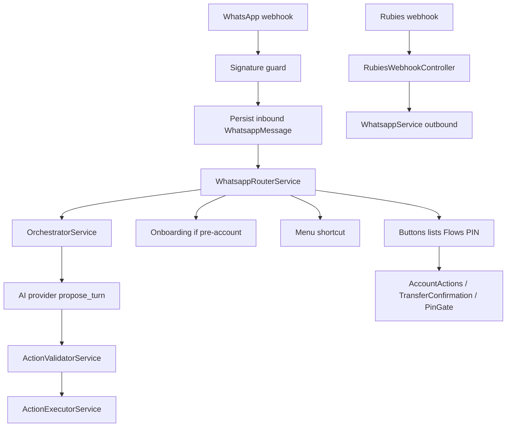

# Architecture

How inbound events become outbound WhatsApp messages and database writes.

## Stack

| Concern | Choice |
| --- | --- |
| Framework | NestJS 10 (Express), `rawBody: true` |
| Language | TypeScript (`strictNullChecks`, `noImplicitAny`) |
| Database | PostgreSQL 16 via Prisma 5 |
| HTTP | Controllers under `whatsapp/` and `rubies/` |
| LLM | Pluggable `AI_PROVIDER` (stub default); Gemini/Anthropic may receive one image per turn |
| Speech-to-text | Deepgram listen (`DEEPGRAM_API_KEY`); no TTS |
| Time | WAT helpers in `src/common/wat-time.util.ts` |
| Default port | 3000 |

## Repository layout

```
src/
  main.ts / app.module.ts
  health/          GET /health — database reachability
  prisma/          Global PrismaService
  config/          env.validation.ts
  allowance/       WindowService, FeeCalculator, AllowanceService, schedulers
  onboarding/      Stage machine
  tagging/         Recipient tags
  manager/         SettingsChangeRequest gate + delayed conversation
  rubies/          RubiesService + webhook controller
  ai/              Provider clients + persona/onboarding prompts
  orchestrator/    OrchestratorService, ActionValidator, surface registry, evals
  whatsapp/        Webhook, router, wizards, PIN gate, ActionExecutor
  pin/             PIN challenge/verify
  cli/             Dry-run CLI (no WhatsApp/Rubies)
  common/
prisma/            schema + migrations
e2e/               Black-box HTTP scenarios
docs/              This tree
initiatives/       Living execution plans
```

`AppModule` does not import `OrchestratorModule` or `AiModule` directly. They are pulled in through `WhatsappModule`.

## Request flow



### Deterministic money path

Confirm / cancel buttons and the transfer wizard never wait on the LLM. `ActionExecutorService` lives in `WhatsappModule` because it needs WhatsApp send + account services. `OrchestratorModule` must stay free of outbound send dependencies.

### Circular Nest imports

`forwardRef` is used between `WhatsappModule` and `AllowanceModule`, `RubiesModule`, `OnboardingModule`, and `ManagerModule` (schedulers and webhooks need `WhatsappService`).

## Data model (high level)

Prisma models (see [`prisma/schema.prisma`](../prisma/schema.prisma)): `User`, `DailyAllowance`, `Recipient`, `Transaction`, `OverrideHistory`, `SettingsChangeRequest`, onboarding/conversation sessions, `TransferDraft`, `WhatsappMessage`, PIN challenges, Rubies webhook receipts, LLM call logs, nudges.

`TransferDraft` is the interactive send-money wizard. `ConversationSession` is chat history for the Udara (`KEDU`) and manager personas. Do not merge them.

## Integrations

| System | Role | Local |
| --- | --- | --- |
| WhatsApp Cloud API | Inbound webhook + outbound Graph sends + media download | `WHATSAPP_DRY_RUN=true` records fake wamids; media download skipped |
| Rubies BaaS | Wallet, name enquiry, transfers, inbound credit | `RUBIES_DRY_RUN=true` returns fakes |
| Deepgram | Inbound voice-note transcription | unset `DEEPGRAM_API_KEY` → type-instead copy |
| LLM providers | Onboarding extraction + orchestrator turns (Gemini/Anthropic may see one image) | `AI_PROVIDER=stub` |

## CLI

[`src/cli/`](../src/cli/) boots a stub Prisma + orchestrator for golden dialogues and fixtures. It must not call Meta or Rubies.

## Operational safety

| Concern | Mechanism |
| --- | --- |
| Health | `GET /health` (Terminus) pings Postgres |
| Shutdown | `enableShutdownHooks()` so Prisma disconnects on SIGTERM |
| Errors | Sentry when `SENTRY_DSN` is set, plus a global filter that keeps stack traces |
| Flood control | Throttler at the edge; a per-user inbound cap in the router, counted off `WhatsappMessage` |
| Duplicate work | Every money transition is an atomic status claim; nudges, emails and weekly reviews claim a unique row before sending |
| Recovery | Schedulers reconcile stuck transfers and bills, repair unapplied spend, retry unswept fees, and report anything past a 7-day horizon |
| Crons in CLIs | `DISABLE_SCHEDULERS=true`, set by the CLI tools themselves |

Schedulers are not leader-elected. Correctness comes from the claims above, so a double run is harmless rather than prevented; in-process flags shed the duplicated load.

## Known structural notes

- Package name `kedu` vs product name Udara.
- CI does not run e2e or live LLM tests. The golden dialogues do run, under jest.
