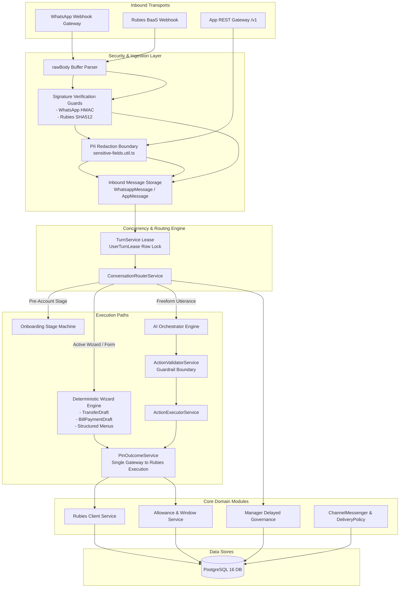
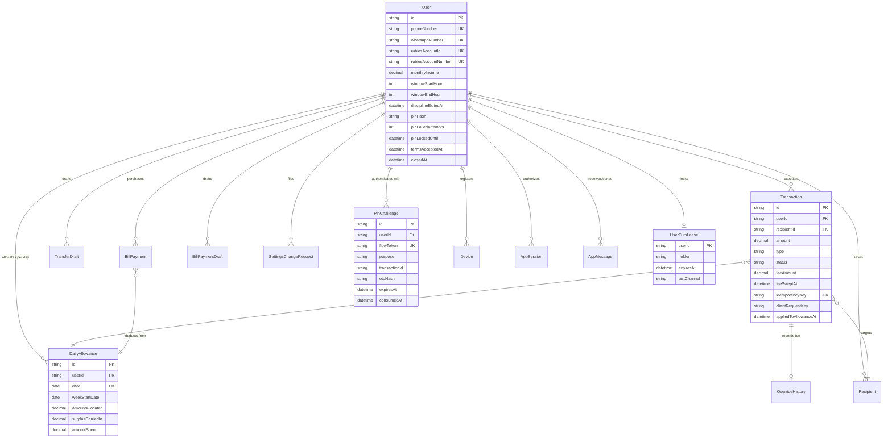
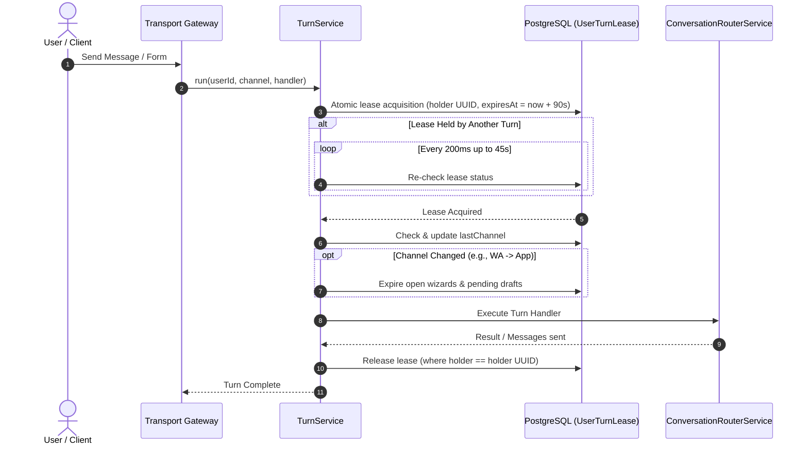
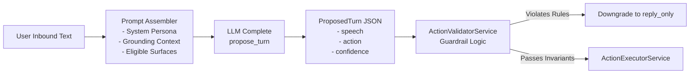
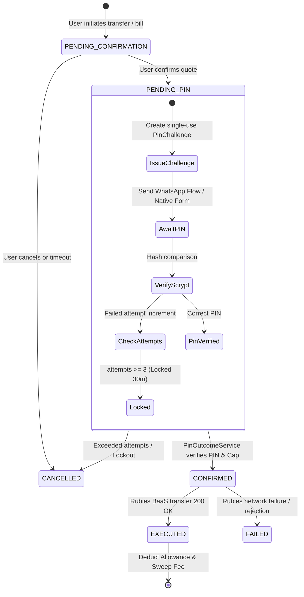
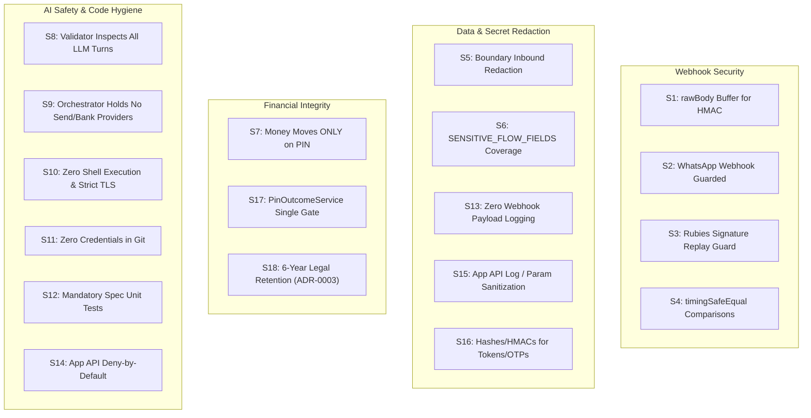

# Udara System Technical Documentation
**Scope:** `/udara` Backend Service  
**Stack:** NestJS 10, TypeScript, PostgreSQL 16 (Prisma 5), WhatsApp Cloud API, Rubies BaaS, LLM Orchestration  
**Status:** Production Reference  

---

## Table of Contents
1. [System Architecture](#1-system-architecture)
   - [1.1 High-Level Overview & Purpose](#11-high-level-overview--purpose)
   - [1.2 Technology Stack](#12-technology-stack)
   - [1.3 Core Architectural Topology](#13-core-architectural-topology)
   - [1.4 Inbound Ingestion & Multi-Channel Transport](#14-inbound-ingestion--multi-channel-transport)
   - [1.5 Request & Message Processing Pipeline](#15-request--message-processing-pipeline)
   - [1.6 Data Model & Entity Relationship Architecture](#16-data-model--entity-relationship-architecture)
2. [Core Algorithms](#2-core-algorithms)
   - [2.1 Financial Discipline & Allowance Engine](#21-financial-discipline--allowance-engine)
   - [2.2 Concurrency & Distributed Lease Control (TurnService)](#22-concurrency--distributed-lease-control-turnservice)
   - [2.3 LLM Orchestration & Guardrail Action Validation](#23-llm-orchestration--guardrail-action-validation)
   - [2.4 PIN Verification & Money Movement State Machine](#24-pin-verification--money-movement-state-machine)
   - [2.5 Delayed Governance & Cool-Off Engine (Manager Path)](#25-delayed-governance--cool-off-engine-manager-path)
3. [Security Design](#3-security-design)
   - [3.1 Threat Model & Critical Protected Assets](#31-threat-model--critical-protected-assets)
   - [3.2 The 18 Non-Negotiable Invariants (S1–S18)](#32-the-18-non-negotiable-invariants-s1s18)
   - [3.3 Cryptographic Standards & Key Derivations](#33-cryptographic-standards--key-derivations)
   - [3.4 Inbound Persistence Redaction & PII Scrubbing Boundary](#34-inbound-persistence-redaction--pii-scrubbing-boundary)
   - [3.5 Idempotency, Replay Defense, and Atomicity](#35-idempotency-replay-defense-and-atomicity)
   - [3.6 Compliance & Regulatory Retention (ADR-0003)](#36-compliance--regulatory-retention-adr-0003)

---

## 1. System Architecture

### 1.1 High-Level Overview & Purpose
Udara is a backend financial discipline and savings system designed to govern real-world bank accounts (hosted via Rubies Microfinance Bank BaaS). Rather than acting as a passive digital wallet or an unrestricted conversational chatbot, Udara acts as a strict financial agent that enforces:
- **Daily Spending Windows:** Restricting routine spending to designated hours (typically 11:00 AM – 8:00 PM WAT).
- **Daily & Weekly Budget Caps:** Derived mathematically from monthly income via the 50/30/20 rule.
- **Deterrent Fees:** Imposing structured surcharges on early-access or borrowed transactions.
- **Deterministic Action Execution:** Disallowing direct money movement by language models; all financial executions require explicit, multi-step confirmation and cryptographic PIN verification.
- **Delayed Governance:** Enforcing a cooling-off period (minimum 7 days) for changes to restrictive settings.

### 1.2 Technology Stack

| Layer / Concern | Technology | Architectural Rationale |
| :--- | :--- | :--- |
| **Runtime & Framework** | Node.js (>=20), NestJS 10 (Express engine) | Modular dependency injection, strict lifecycle management, structured middleware pipeline. |
| **Language** | TypeScript (Strict mode: `strictNullChecks`, `noImplicitAny`) | Type safety across financial calculations, state transitions, and DTO contracts. |
| **Database & ORM** | PostgreSQL 16 + Prisma ORM 5 | ACID compliance, unique compound constraints for deduplication, schema migrations. |
| **Banking Integration** | Rubies MFB BaaS API | Virtual wallet provisioning, interbank name lookup, funds transfer, utility bill purchases, inbound webhooks. |
| **Messaging Channels** | WhatsApp Cloud API (Graph API) + Mobile REST API (`/v1`) | Primary conversational interfaces; support for Interactive WhatsApp Flows and native mobile JSON forms. |
| **Audio Processing** | Deepgram Listen API | Inbound voice-note transcription directly to text before turn execution. |
| **AI / LLM Providers** | Pluggable Provider Interface (Anthropic Claude, Gemini, OpenRouter, AWS Bedrock, Stub) | Conversational turns, onboarding extraction, and intent classification. Treated strictly as untrusted proposal generators. |
| **Notification / Email** | Resend API | Transactional alerts, monthly summaries, PIN reset codes, device login notices. |
| **Observability** | Sentry SDK + Terminus Health Checks | Crash reporting, stack trace sanitization, database ping on `/health`. |

---

### 1.3 Core Architectural Topology



---

### 1.4 Inbound Ingestion & Multi-Channel Transport

Domain services never interface directly with channel-specific transport classes like `WhatsappService`. Instead, all outbound traffic flows through `ChannelMessenger` (`src/messaging/channel-messenger.ts`), implementing a multi-channel delivery abstraction:

1. **Active Inbound Context (`runInChannel`):** When handling an incoming request, an `AsyncLocalStorage` context stores the active channel (`WHATSAPP` or `APP`). Replies naturally route back to the originating transport.
2. **Asynchronous / Proactive Context (`decideDelivery`):** For asynchronous operations (scheduled notifications, Rubies webhook updates, reconciliation jobs, ops CLI commands):
   - Payment receipts route to the channel where the transaction was quoted (`originChannel`).
   - Standard notifications route to the user's most recently active channel.
   - WhatsApp delivery is only attempted within Meta's 24-hour messaging window unless the user has no registered mobile app.
3. **Channel-Specific Adapters:**
   - `WhatsappChannelAdapter`: Maps generic messenger payloads to WhatsApp Cloud API templates, text chunks, buttons, lists, or interactive Flow tokens.
   - `AppChannelAdapter`: Persists messages as `AppMessage` rows with autoincrementing `seq` cursors for polling clients, triggering push alerts via `PushService` (Expo).

---

### 1.5 Request & Message Processing Pipeline

1. **Raw Body Capturing:** NestJS initializes Express with `rawBody: true` (`src/main.ts`), preserving exact byte streams required for HMAC verification.
2. **Signature Verification:** Requests pass through constant-time guards (`WhatsappSignatureGuard` using HMAC-SHA256, `RubiesSignatureGuard` using SHA-512 with replay tolerance).
3. **Inbound Persistence & Redaction:** Payload rows are committed immediately. All sensitive fields (BVN, NIN, DOB, PIN, OTP) are stripped or replaced with redaction placeholders (`[REDACTED]`) before database insertion.
4. **Per-User Concurrency Lease:** `TurnService` acquires an exclusive database lease (`UserTurnLease`) for the targeted user. If an active turn exists, subsequent turns queue up to `TURN_WAIT_MS` (45 seconds) to prevent race conditions.
5. **Channel Switch Detection:** If a user moves between WhatsApp and the Mobile App, open drafts and pending confirmations are cleanly expired to prevent cross-channel context contamination.
6. **Router Dispatching:** `ConversationRouterService` inspects the state:
   - If an interactive wizard is active (`TransferDraft`, `BillPaymentDraft`), input is routed to the wizard step machine.
   - If onboarding is incomplete, input routes to `OnboardingService`.
   - If a structured button or list reply was clicked, it routes to `AccountActions` or `TransferConfirmationService`.
   - Otherwise, the message is dispatched to `OrchestratorService` for LLM evaluation.

---

### 1.6 Data Model & Entity Relationship Architecture



---

## 2. Core Algorithms

### 2.1 Financial Discipline & Allowance Engine

The allowance engine governs spending limits, window enforcement, and penalty fee calculations without relying on AI decision-making.

#### 2.1.1 Universal Budgeting Formula (50/30/20 Rule)
During onboarding (Stage 7), Udara extracts the user's verifiable monthly income. Regardless of income tier, spending allowance is determined uniformly:

$$\text{Monthly Wants Allowance} = \text{Monthly Income} \times 0.30$$

$$\text{Daily Planned Limit} = \frac{\text{Monthly Wants Allowance}}{30}$$

A fixed 30-day denominator is used to prevent daily limit fluctuations across months of differing calendar lengths.

#### 2.1.2 Daily Rollover & Surplus Accumulation
Allowances are calculated in West Africa Time (WAT, UTC+1). When `getOrCreateTodayAllowance(userId, now)` runs:
1. It queries or creates the `DailyAllowance` record for `watDateBucketKey(now)`.
2. If yesterday's record exists and shares the same ISO week start date (`weekStartDate`):
   $$\text{Surplus}_{\text{yesterday}} = \text{Allocated}_{\text{yesterday}} + \text{SurplusCarriedIn}_{\text{yesterday}} - \text{Spent}_{\text{yesterday}}$$
   $$\text{SurplusCarriedIn}_{\text{today}} = \max(0, \text{Surplus}_{\text{yesterday}})$$
3. **Weekly Reset:** On Monday 00:00 WAT, `weekStartDate` advances. Unspent funds do not cross week boundaries, preventing long-term accumulation that would undermine daily discipline.
4. **Sunday Review Overrides:** If a user negotiates a one-week limit adjustment during the Sunday review, `dailyLimitOverride` is honored strictly for that specific ISO week and automatically lapses thereafter.

#### 2.1.3 Spend Evaluation (`evaluateSpend`)
Before quotes are generated, every transaction is categorized into one of three behavioral types:

```
Algorithm: EvaluateSpend(userId, amount, now)
---------------------------------------------
1. If user.disciplineExitedAt is set:
       Return { type: NORMAL, fee: 0, withinWindow: true }
2. withinWindow = (getWatHour(now) >= user.windowStartHour) AND 
                   (getWatHour(now) < user.windowEndHour)
3. remainingToday = allowance.amountAllocated + allowance.surplusCarriedIn - allowance.amountSpent
4. If NOT withinWindow:
       type = EARLY_ACCESS
   Else if amount > remainingToday:
       type = BORROWED
   Else:
       type = NORMAL
5. fee = FeeCalculator.calculate(type, amount, allowance.surplusCarriedIn)
6. Return { type, feeAmount: fee.feeAmount, waived: fee.waived, totalCost: amount + fee.feeAmount }
```

#### 2.1.4 Surcharge Math (`FeeCalculatorService`)
Surcharges are calculated using static formulas:
- **`NORMAL`:** $\text{Fee} = 0$
- **`EARLY_ACCESS` (Outside Window):**
  $$\text{Fee} = ₦1,000 + (\text{Amount} \times 0.002)$$
- **`BORROWED` (Exceeding Daily Limit):**
  - If $\text{SurplusAvailable} \ge \text{Amount}$: Fee is **waived** ($\text{Fee} = 0, \text{waived} = \text{true}$).
  - If $\text{SurplusAvailable} < \text{Amount}$:
    $$\text{Fee} = ₦1,000 + (\text{Amount} \times 0.004)$$

#### 2.1.5 Fee Sweep Lifecycle
Surcharges are collected via a secondary transfer to a dedicated fees wallet (`RUBIES_FEES_ACCOUNT_NUMBER`):
- Because the fee sweep runs after the main debit, insufficient funds may cause the sweep to fail.
- The system leases sweep claims via `feeSweepAttempts` and `feeSweepLastTryAt` timestamps, allowing an hourly retry worker to sweep pending fees safely without infinite blocking.

---

### 2.2 Concurrency & Distributed Lease Control (TurnService)

Udara enforces a single-active-turn invariant per user across multiple replicas and delivery channels using PostgreSQL row-level locks via `UserTurnLease`.



- **Lease Timeout (TTL):** Default `90,000ms`. Protects against crashed application instances.
- **Acquire Polling:** Retries every `200ms` up to `45,000ms`. If acquisition times out, execution proceeds with a degraded warning, prioritizing responsiveness over indefinite message starvation.

---

### 2.3 LLM Orchestration & Guardrail Action Validation

The language model is treated as an untrusted agent proposing transitions. The boundary rule is: **"The model proposes, code disposes."**



#### ActionValidatorService Invariants
1. **Confidence Checks:** Proposed actions must have `HIGH` confidence. Any `MEDIUM` or `LOW` confidence rating is downgraded to `reply_only`.
2. **Surface Eligibility:** The proposed `surface_key` must exist in `eligibleSurfaces` derived from user state (e.g., `transfer_wizard` is ineligible if the user has no bank account or onboarding is active).
3. **Spend-Check Interception:** Utterances containing transfer intents pause execution to prompt a spend evaluation before presenting the interactive transfer wizard.
4. **Digit Attestation (`attested-digits.util.ts`):** Extracted account numbers or amounts must match literal character sequences present in the conversation context. The model cannot hallucinate or infer numbers not explicitly provided by the user.
5. **Bill vs. Transfer Isolation:** Utterances containing utility keywords (e.g., "NEPA", "data", "airtime") are blocked from promoting onto `transfer_wizard`.

---

### 2.4 PIN Verification & Money Movement State Machine

All money movement follows a deterministic 7-step state machine. `PinOutcomeService` is the sole execution point for transfers.



#### Step Details:
1. **Quote Creation (`createQuote`):** Re-reads recipient and balance information from the database. Calculates fees and locks in total cost.
2. **User Confirmation (`evaluateConfirm`):** The user taps "Confirm" on a quote card. Transaction transitions to `PENDING_PIN`.
3. **Challenge Issuance (`PinService.issueChallenge`):** Generates a cryptographically random `flowToken` bound to the transaction ID with an expiration of 15 minutes.
4. **PIN Evaluation:** PIN inputs are validated against `pinHash` using `scrypt`. Three consecutive invalid attempts lock the PIN for 30 minutes (`pinLockedUntil`).
5. **New-Device Transfer Cap:** `PinOutcomeService` checks whether the authenticated device is newly trusted (< 24 hours). Cumulative transfers are capped at ₦20,000 until the restriction window expires.
6. **Execution (`executeVerifiedTransfer`):** Generates a UUID `idempotencyKey` and executes the transfer via the Rubies API.
7. **Post-Execution Sync:**
   - Marks transaction `EXECUTED`.
   - Records spend in `DailyAllowance` via `recordSpend`.
   - Queues fee deduction via `sweepFeeToFeesAccount`.

---

### 2.5 Delayed Governance & Cool-Off Engine (Manager Path)

To prevent impulsive overrides of financial discipline settings, setting changes (modifying spending window hours, altering fees, or exiting restrictions) are governed by the **Manager Persona** and a mandatory cooling-off mechanism.

1. **Request Filing (`fileChangeRequest`):** When a user requests a limit or setting adjustment, a `SettingsChangeRequest` is created:
   $$\text{EligibleAt} = \text{RequestedAt} + 7 \text{ days}$$
2. **Delayed Acknowledgment:** The initial acknowledgment reply is deliberately delayed by a variable window (e.g., 2–4 hours) via `initialReplyDueAt` to allow impulsive feelings to subside.
3. **Execution Gate:** No API, conversation route, or administrative script can approve a request where `now() < eligibleAt`.
4. **Review & Decision:** Requests can only be processed after `eligibleAt` has passed using the operator CLI (`npm run settings:decide`).
5. **Withdrawal:** Users may withdraw pending requests at any time before approval.

---

## 3. Security Design

### 3.1 Threat Model & Critical Protected Assets

| Asset / Boundary | Threat Vector | Mitigation Strategy |
| :--- | :--- | :--- |
| **Customer Funds** | Accidental double debits, prompt injection transfer creation, forged webhooks. | Database-backed idempotency keys, isolation of LLM from execution code, constant-time signature verification. |
| **User Transfer PIN** | Plaintext interception, brute-force guessing, credential stuffing. | Parameter-encoded scrypt hashing, 3-attempt lockout policies, single-use `flowToken` binding, zero logging. |
| **Identity Data (BVN, NIN, DOB)** | Accidental database exposure, webhook log leakage. | Immediate boundary redaction in ingestion controllers, encryption of storage volumes, zero logging of raw payloads. |
| **Discipline Rules** | LLM jailbreaking, client-side limit bypass. | Fully deterministic allowance rules evaluated purely in code; the LLM cannot modify allowance records. |
| **Mobile App Endpoints** | Unauthorized API access, brute-force OTP attacks. | Global deny-by-default guard (`AppAuthGuard`), HMAC verification of sign-in codes, device session tracking with family revocation. |

---

### 3.2 The 18 Non-Negotiable Invariants (S1–S18)

These invariants are enforced in the codebase and verified by automated CI checks (`npm run security:check`).



| Invariant | Summary Description | Enforcement Point |
| :--- | :--- | :--- |
| **S1** | Webhook HMAC is computed over unmodified raw bytes. | `src/main.ts` (`rawBody: true`). |
| **S2** | WhatsApp webhook endpoint is protected by signature guards. | `whatsapp-signature.guard.ts`. |
| **S3** | Rubies webhook is protected by signature verification with replay tolerance. | `rubies-signature.guard.ts`. |
| **S4** | All cryptographic hash and signature comparisons use constant-time operations. | `crypto.timingSafeEqual`. |
| **S5** | Inbound payloads are redacted before persistence to the database. | `sensitive-fields.util.ts`, `app-message.service.ts`. |
| **S6** | Every sensitive field declared in WhatsApp Flows is registered in the redaction list. | `SENSITIVE_FLOW_FIELDS` vs flow JSON schemas. |
| **S7** | Money can only move after successful PIN verification. | `TransactionStatus.PENDING_PIN` checks. |
| **S8** | Every LLM proposal must pass through deterministic validation before taking effect. | `ActionValidatorService.validate`. |
| **S9** | `OrchestratorModule` must contain no outbound messaging or banking provider dependencies. | `orchestrator.module.ts`. |
| **S10** | Application code in `src/` must never invoke shell commands or disable TLS verification. | CI AST inspection script (`check-security.js`). |
| **S11** | Zero secrets, private keys, or credentials committed to source control. | CI secret regex scanner. |
| **S12** | All security-critical files must have accompanying unit test suites. | Colocated `*.spec.ts` files. |
| **S13** | Webhook controllers must never serialize inbound payloads into application logs. | `whatsapp.controller.ts`, `rubies-webhook.controller.ts`. |
| **S14** | Mobile REST API (`/v1`) denies requests by default; endpoints require active sessions unless marked `@Public()`. | `AppAuthGuard` registered globally. |
| **S15** | App API controllers must not log request payloads; secrets are never passed in query parameters. | DTO class validation and controller design. |
| **S16** | OTPs and session tokens must be stored exclusively as hashes or HMACs. | `secret-hash.util.ts`. |
| **S17** | Money execution routes through `PinOutcomeService` exclusively; native transfers require an `Idempotency-Key`. | `pin-outcome.service.ts`, `transfers.controller.ts`. |
| **S18** | Account closure retains statutory regulatory records for 6 years; the LLM cannot trigger account deletion. | `account-closure.service.ts`, `ADR-0003`. |

---

### 3.3 Cryptographic Standards & Key Derivations

#### 3.3.1 PIN Security (Scrypt KDF)
PINs are never stored in plaintext or recoverable formats. They are hashed using `scrypt`:
- **Parameters:** $N=16384$, $r=8$, $p=1$, key length = 64 bytes.
- **Salt:** Cryptographically random 16-byte salt per user.
- **Encoded Format:** `$scrypt$N=16384,r=8,p=1$base64(salt)$base64(hash)`.
- **Lockout Policy:** Because a 4-digit PIN has only 10,000 possible combinations, security relies primarily on attempt throttling (`pinFailedAttempts >= 3` initiates a 30-minute lockout in `pinLockedUntil`).

#### 3.3.2 Session Tokens & Refresh Rotation
Mobile sessions use dual-token authentication:
- **Access Tokens:** Short-lived (15 minutes). Stored in the database as a SHA-256 hash (`accessHash`).
- **Refresh Tokens:** Long-lived (30 days). Stored as a SHA-256 hash (`refreshHash`).
- **Family Rotation:** Refreshing a session invalidates the current refresh token and issues a new pair within the same `familyId`. If a previously used (rotated) refresh token is presented, the entire `familyId` session tree is immediately revoked to stop replay attacks.

#### 3.3.3 SMS OTP Hashing
- OTPs are 6-digit random codes valid for 5 minutes.
- Stored as `HMAC-SHA256(OTP_PEPPER, "phoneNumber:code")`.
- Capped at 3 verification attempts per issuance.

---

### 3.4 Inbound Persistence Redaction & PII Scrubbing Boundary

Because incoming WhatsApp messages are written to `WhatsappMessage` before routing occurs, redaction must happen at the persistence boundary (`src/common/sensitive-fields.util.ts`):

```typescript
// Core Redaction Logic (sensitive-fields.util.ts)
export const SENSITIVE_FLOW_FIELDS = [
  "pin", "new_pin", "confirm_pin", "bvn", "nin", 
  "date_of_birth", "dob", "password", "otp"
];

export function redactSensitivePayload(payload: any): any {
  // Recursively traverses objects/arrays. Replaces any key matching 
  // SENSITIVE_FLOW_FIELDS or regex /pin|bvn|nin|password|otp/i with "[REDACTED]"
}
```

For unstructured freeform chat text, `scrubFreeTextSecrets` scans for 11-digit numbers resembling BVN or NIN patterns and masks them prior to persisting `AppMessage` or `WhatsappMessage` records.

---

### 3.5 Idempotency, Replay Defense, and Atomicity

To guarantee financial consistency across network interruptions and webhook retries:
1. **WhatsApp Deduplication:** The unique constraint on `WhatsappMessage.waMessageId` prevents duplicate webhook deliveries from triggering multiple execution turns.
2. **Transfer Idempotency:** Transfers generate a client-bound UUID `clientRequestKey` and a Rubies-bound `idempotencyKey`. If a client retries a transaction quote, the unique constraint `@@unique([userId, clientRequestKey])` guarantees that existing quotes are returned rather than re-evaluated.
3. **Double-Spend Prevention:** When updating allowances during transaction settlement, transactions check and update `appliedToAllowanceAt` atomically:
   ```sql
   UPDATE "Transaction"
   SET "status" = 'EXECUTED', "appliedToAllowanceAt" = NOW()
   WHERE "id" = :id AND "appliedToAllowanceAt" IS NULL;
   ```
4. **Notification Deduplication:** Schedulers generating proactive nudges and emails populate unique `dedupeKey` fields (e.g., `WINDOW_OPEN:userId:YYYY-MM-DD`) prior to dispatch, preventing duplicate messaging during scheduler retries.

---

### 3.6 Compliance & Regulatory Retention (ADR-0003)

Under Central Bank of Nigeria (CBN) regulations and anti-money laundering (AML) requirements, financial platforms must retain customer identification, accounting ledgers, and transaction histories for a minimum of **six years**.

Udara implements these requirements via `AccountClosureService` (`src/account-closure/`):
- **Permanent Ledger Retention:** User transaction logs, bill payments, incoming credits, KYC legal names, and conversation records are flagged and archived; they are never deleted.
- **PII Scrubbing:** Ephemeral authentication credentials (PIN hashes, active app sessions, device push tokens, and phone numbers) are scrubbed. The user's active phone number is reassigned to `closed:<uuid>`, releasing the original telephone number for future onboarding if desired.
- **Guardrails Against Automated Erasure:**
  - Setting change types explicitly omit `ACCOUNT_DELETION` from conversational AI awareness.
  - Account closures can only be executed via the operator CLI (`npm run account:close`) following a mandatory 7-day withdrawal window.
