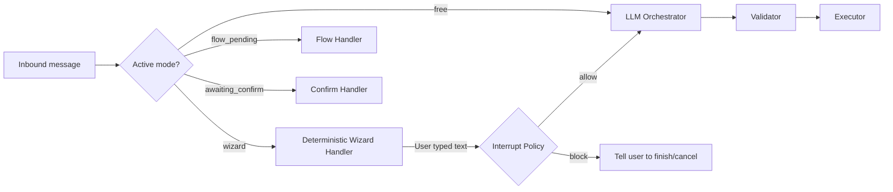

# AI Orchestrator Architecture Plan

> **Status:** Phase 0–1 implemented (ActionExecutor, validator confidence, timeout SOP, golden evals). Phase 2 (activeMode / interrupts / KYC Flow) still open.  
> **Audience:** ML engineers, backend engineers  
> **Goal:** Make the AI the conductor of the WhatsApp experience — deciding when to chat, when to show lists/buttons, and when to launch WhatsApp Flows — while keeping money, compliance, and regulated data fully deterministic.

---

## 1. Vision

Udara/Kedu is a **proactive financial discipline agent on WhatsApp**. Users should feel like they are talking to a person (Kedu/Udara persona), but the system must become **structured exactly when structure matters**.

The AI should:
- Own the **conversation flow** — empathy, explanation, nudging, clarifying intent
- Decide **which UX surface** to present next (text, list, buttons, WhatsApp Flow)
- **Never** call banking APIs or write financial state directly

Deterministic code should:
- Validate every AI proposal against hard business rules and state machines
- Execute UI sends (`sendText`, `sendListMessage`, `sendFlow`, confirm buttons)
- Own all money movement, allowance checks, fee calculation, and KYC parsing

**One-line summary:**
> LLM proposes the next turn; code validates and executes it.

---

## 2. Problem with the current architecture

Today the system is **router-first, AI-second**:

```
Inbound message
  → if regex command        → deterministic action
  → else if intent classifier → menu action (balance/limits/transfer)
  → else                      → KeduChat (text only, no tools)
```

Key gaps:
| Gap | Impact |
|-----|--------|
| `KeduChatService` has no tools | AI can talk but cannot trigger Flows, menus, or wizards |
| WhatsApp Flows are hardcoded | Only KYC in `OnboardingService`; not AI-orchestrated |
| Transfer uses a separate wizard | Lists/buttons in `AccountActionsService`, disconnected from chat |
| Intent classifier is narrow | Maps to menu actions only, not surfaces or Flows |
| Split brain | User talks to "Kedu" but system silently switches to rigid parsing |
| Context bloat | System prompts grow unbounded, degrading LLM accuracy and latency |

The AI is a **fallback chat layer**, not the orchestrator. That is why the experience feels disjointed.

---

## 3. Target architecture: Orchestrator + Action Executor

Three layers on every conversational turn:

```mermaid
flowchart TD
    subgraph input [Inbound]
        msg[WhatsApp message]
        state[Load session state, active mode + live facts]
    end

    subgraph brain [AI layer — proposes only]
        orch[Dialogue Orchestrator]
        prune[Prune Surface Registry to Eligible Only]
        orch --> prune --> proposal[Proposed turn: text + optional UI action + confidence]
    end

    subgraph gate [Policy layer — deterministic]
        val[Action Validator]
        val --> allowed{Allowed & High Confidence?}
    end

    subgraph exec [Execution layer — deterministic]
        ui[UI Renderer]
        domain[Domain services]
        bank[Rubies / DB writes]
    end

    msg --> state --> orch
    proposal --> val
    allowed -->|Yes| ui
    allowed -->|Yes| domain
    domain --> bank
    allowed -->|No (or Med Confidence)| fallback[Safe fallback: Text only / Menu]
    fallback --> ui
```

### Layer 1 — Dialogue Orchestrator (LLM)
Single agent per turn that outputs a **structured turn plan**, not just free text.

Responsibilities:
- Read user message + strictly budgeted context block (history, facts, mode)
- Choose the best **modality** for this moment from a **dynamically pruned** list of eligible surfaces
- Write user-facing text in Kedu/Udara voice
- Emit a structured `propose_turn_action` tool call with a **confidence score**

Does **not**:
- Call Rubies, execute transfers, or parse Flow JSON

### Layer 2 — Action Validator (deterministic)
Every orchestrator proposal passes through hard rules before execution.

Responsibilities:
- Check preconditions (onboarding stage, account exists, active draft)
- Evaluate LLM **confidence**: if the LLM proposes a surface with "medium" confidence, safely downgrade to a text-only confirmation to avoid jarring UI popups.
- Reject unsafe or ineligible actions, log proposal vs outcome for audit/eval.

### Layer 3 — UI Executor + Domain Services (deterministic)
Responsibilities:
- **Persona Wrapping:** Send the orchestrator's generated conversational text first, *then* send the deterministic UI (e.g., the balance read out). This humanizes robotic API responses.
- Call WhatsApp APIs (`sendText`, `sendFlow`, etc.) and domain services.

---

## 4. Modality Registry (Runtime-Pruned)

The orchestrator does not receive raw Meta API details. It receives a **catalog of surfaces** with semantic descriptions.

**Critical ML Optimization:** The LLM is NOT shown all surfaces every turn. Before the prompt is built, the registry is pruned based on `preconditions`. Showing an LLM 3 valid choices yields much higher accuracy than showing it 7 choices where 4 are currently impossible.

```typescript
type SurfaceKind = "text" | "list" | "buttons" | "whatsapp_flow" | "wizard";

interface SurfaceDefinition {
  key: string;
  kind: SurfaceKind;
  description: string;           // When to use — shown to the model
  preconditions: string[];       // Machine-checkable rules (e.g., "user.rubiesAccountNumber exists") — NOT shown to model
  interruptPolicy: "block" | "allow" | "pause"; // How to handle free-text during this surface
  prefillSchema?: Record<string, string>; // Strictly bounds what the LLM can extract
  handler: string;
}
```

### Example Eligible Surfaces

| Interaction | Surface | Precondition | Interrupt Policy |
|-------------|---------|--------------|------------------|
| KYC (BVN/NIN) | `whatsapp_flow` | `stage >= PLAN_PROPOSED`, `no rubies account` | `allow` (Route to Orchestrator) |
| Transfer Wizard | `wizard` | `onboarding complete`, `has rubies account` | `block` (Force finish/cancel) |
| Transfer Confirm | `buttons` | `pending transfer draft with fee quote` | `block` (Resend prompt) |
| Main Menu | `list` | `onboarding complete` | `allow` |
| Balance / Limits | `text` | `has rubies account` | `allow` |

---

## 5. Inbound routing & Active Mode State Machine

Replace the current router tree with **explicit Active Mode routing**. The mode must be stored in `ConversationSession.contextData` and cleared when a flow completes or cancels.

**Active Modes:**
- `free`: AI orchestrates normally.
- `wizard`: Mid-transfer.
- `flow_pending`: Waiting for a WhatsApp Flow submission.
- `awaiting_confirm`: Waiting for a button tap.



---

## 6. Orchestrator tool schema (with Confidence & Strict Prefills)

The orchestrator uses **forced tool calling** (`forceTool: true`).

```json
{
  "name": "propose_turn",
  "description": "Decide what to say and optionally which UI surface to show this turn.",
  "parameters": {
    "type": "object",
    "required": ["message", "action"],
    "properties": {
      "message": {
        "type": "string",
        "description": "Reply in Kedu/Udara voice. Always required."
      },
      "action": {
        "type": "object",
        "required": ["type"],
        "properties": {
          "type": {
            "type": "string",
            "enum": ["reply_only", "show_surface", "resend_surface"]
          },
          "surface_key": {
            "type": "string",
            "description": "Must be from the eligible surfaces list provided in the prompt."
          },
          "extracted_hints": {
            "type": "object",
            "description": "Optional constrained pre-fill data.",
            "properties": {
              "amount": { "type": "number", "description": "Transfer amount in naira" },
              "label_hint": { "type": "string", "enum": ["RENT", "FOOD", "VENDOR", "OTHER"] }
            }
          },
          "confidence": {
            "type": "string",
            "enum": ["high", "medium"],
            "description": "Use 'medium' when the intent is plausible but ambiguous. The system will safely text the user to clarify before popping UI."
          },
          "reasoning": {
            "type": "string",
            "description": "Internal reason for audit log."
          }
        }
      }
    }
  }
}
```

---

## 7. Context Assembly & Token Budget

To prevent context bloat and latency spikes, every orchestrator call builds context with a **strict token budget**. History is dynamically capped (e.g., last 10 messages instead of 20, optimizing for tool-call precision over deep recall).

| Section | Budget Target | Notes |
|---------|---------------|-------|
| 1. Persona + Voice rules | ~600 tokens | `kedu-persona.prompts.ts` |
| 2. Orchestrator instructions | ~300 tokens | How to use the tool |
| 3. Eligible surfaces | ~200 tokens | **Pruned runtime list only** |
| 4. Live facts | ~100 tokens | WAT time, window, allowance |
| 5. User state snapshot | ~80 tokens | Onboarding stage, mode, restrictions |
| 6. Guardrail reminders | ~150 tokens | Never guess balances, etc. |
| 7. Recent history | ~800 tokens | Capped at ~10 recent turns |
| **TOTAL** | **~2230 tokens** | Fast generation, focused context |

---

## 8. Validator rules & Latency Strategy

### Validation Matrix
| Proposed action | Confidence | Validator checks | On reject / downgrade |
|-----------------|------------|------------------|-----------------------|
| `show_surface:any` | **Medium** | - | Downgrade to `reply_only` (send text, let user clarify) |
| `show_surface:transfer_wizard` | High | Onboarding complete; has account | Reject to text: "No account yet" |
| `reply_only` about money | N/A | If user asked balance, prefer read surface | Substitute `balance_read` |
| Execute transfer | N/A | **Never allowed** | Hard block |

### Latency & Failure Strategy
- **Target:** Orchestrator call < 2-3s.
- **Timeout (> 4s):** Deterministic fallback text ("Hey, give me a sec...") + single retry.
- **Hard Failure:** Safe fallback apology + trigger Main Menu list. Never drop the message silently.

---

## 9. Fintech guardrails
These must not be relaxed for UX smoothness:
1. **LLM proposes, never commits** — no `executeTransfer()` tool on the model
2. **All money writes** go through existing domain services unchanged
3. **Confirm surfaces are mandatory** for outbound payments
4. **Structured data parsed deterministically** — KYC, Flow submissions, button IDs
5. **Fail-safe defaults** — orchestrator failure → safe text + main menu, never silent wrong action
6. **Persona Wrapping** — AI conversational text is prepended to deterministic API responses to maintain illusion of agency without hallucinating facts.

---

## 10. Model strategy

**Single Orchestrator with Forced Tool Call (v1)**
- One conversation model (`CONVERSATION_LLM`) per turn. 
- `forceTool: true` on `propose_turn`.
- Handles both intent classification AND persona reply in one pass.
- **Pros:** One brain, seamless UX, persona text perfectly aligns with chosen surface.
- **Cons:** Slightly higher latency than a pure classifier, but offset by the strict token budget.

---

## 11. Proposed module structure

```
src/
  orchestrator/
    orchestrator.module.ts           # Exports OrchestratorService + ActionValidator
    orchestrator.service.ts          # Assemble context, prune registry, call LLM, validate
    orchestrator.types.ts            # ProposedTurn, OrchestratorResult, timeout constants
    surface-registry.ts              # Catalog of surfaces + isEligible predicates
    action-validator.service.ts      # Hard rule checks & confidence downgrades
    action-executor.service.ts       # Persona wrap + surface dispatch + failure SOP
                                     # (provided by WhatsappModule — needs WhatsApp deps)
    prompts/
      orchestrator-system.prompt.ts  # Budgeted prompt builder
    evals/
      golden-dialogues.json          # Offline validator contract fixtures
      golden-dialogues.spec.ts

  whatsapp/
    whatsapp-router.service.ts       # Shortcuts / wizard / onboarding, then orchestrator+executor
```

---

## 12. Migration plan (phased)

### Phase 0 — Foundation
- [x] Create `SurfaceRegistry` with `isEligible` preconditions (interrupt policies deferred to Phase 2).
- [x] Create `ActionValidator` to handle preconditions and confidence downgrades (missing confidence = medium).
- [x] Build `OrchestratorService` to assemble budgeted context and call LLM.
- [x] Explicit `ActionExecutorService` (persona wrap + surface dispatch + failure SOP).

### Phase 1 — Orchestrator for post-onboarding chat
- [x] Wire `OrchestratorService` into `WhatsappRouterService`.
- [x] Replace intent classifier and `KeduChatService` fallthrough with orchestrator + executor.
- [x] Surface dispatch via `ActionExecutor` (not inline router `executeSurface`).
- [x] Transfer amount prefill via `extractedHints`.
- [x] 4s LLM timeout + hard-fail → apology + main menu.
- [x] `ORCHESTRATOR_TURN` audit purpose + `markApplied` proposed/validated payload.
- [x] Offline golden-dialogue validator contract (`src/orchestrator/evals/`).
- [ ] Add `activeMode` state tracking to `ConversationSession` (deferred — Phase 2).

### Phase 2 — Flow orchestration & Interrupts
- [ ] Implement the `interruptPolicy` logic in the router (blocking vs routing to LLM).
- [ ] Register KYC Flow in registry; allow orchestrator to trigger it.
- [ ] Persist/clear `activeMode` on session for wizard / flow_pending / awaiting_confirm.

### Phase 3 — Cleanup & Eval
- [ ] Delete unused `IntentRouterService` and `KeduChatService` files (removed from live router path; still registered for legacy unit specs).
- [x] Offline golden dialogues against validator (live-provider regression still open).

---

## 13. Evaluation strategy (ML engineering)

Build a concrete golden dialogue set using this test record schema:

```json
{
  "test_case_id": "tx_intent_01",
  "history": [{"role": "user", "content": "send 5k to my landlord"}],
  "expected_surface": "transfer_wizard",
  "expected_confidence": "high",
  "forbidden_surfaces": ["balance_read", "limits_read"]
}
```

**Key Metrics:**
1. **Precision/Recall on surface selection**
2. **False Positive Rate:** Triggers on casual chat (should be mitigated by `confidence: medium` downgrade).
3. **Latency:** p50/p95 of the orchestrated turn.
4. **Validation Rejection Rate:** How often the LLM proposes an ineligible surface (measures prompt pruning effectiveness).

---

## 14. Example end-to-end: transfer journey

```
1. User: "send 15k to my landlord"
2. Router: activeMode = free → Orchestrator
3. Orchestrator: Prunes registry. Builds context. Calls LLM.
4. LLM proposes:
     message: "Got it — I'll pull up the transfer form..."
     action: { type: show_surface, surface_key: transfer_wizard, extracted_hints: { amount: 15000 }, confidence: high }
5. Validator: Checks account exists ✓. Checks confidence (high) ✓.
6. Router (Executor): 
     a. Sends message: "Got it — I'll pull up the transfer form..." (Persona wrapping)
     b. Dispatches `transfer_wizard` to AccountActionsService.
     c. Sets activeMode = wizard.
7. User completes wizard steps (deterministic handlers intercepting via activeMode).
8. Executor: sends confirm buttons. User taps Confirm.
9. TransferConfirmationService → Rubies.
10. activeMode cleared.
```

---

## 14b. CLI dry-run (local agent testing)

Safe local path to exercise Orchestrator → Validator **without** WhatsApp, Rubies, or transfers.

```bash
npm run orchestrator:cli
npm run orchestrator:golden
npm run orchestrator:fixture -- ./src/cli/sample-fixture.json "send 5k"

# Most reliable on Windows PowerShell — call ts-node directly:
npx ts-node -r tsconfig-paths/register src/cli/orchestrator-cli.ts --golden
npx ts-node -r tsconfig-paths/register src/cli/orchestrator-cli.ts --fixture ./src/cli/sample-fixture.json --message "send 5k"
```

Notes:

- Banner always prints `DRY-RUN — no WhatsApp, no Rubies, no transfers`.
- Default `AI_PROVIDER=stub` does not emit tool calls → expect `ok: false` unless you pass a fixture or set a real provider.
- `--fixture` accepts a `ProposedTurn` JSON **or** a golden case object with `mock_proposal` (see `src/cli/sample-fixture.json`).
- `--golden` / `npm run orchestrator:golden` replays all golden dialogues through the validator only (no LLM); exits non-zero on failure.
- `--no-account` prunes surfaces as if the user has no Rubies wallet.
- Session history and LLM audit logs stay in-memory (no Prisma writes).
- Env fallbacks if flags get dropped: `ORCHESTRATOR_GOLDEN=1`, `ORCHESTRATOR_MESSAGE`, `ORCHESTRATOR_FIXTURE`.

---

## 14c. Black-box e2e (BrandDrive-style)

HTTP scenario suite under [`e2e/`](../e2e/) — posts WhatsApp webhooks to a **running** Nest server and asserts via Postgres (outbound `WhatsappMessage`, drafts, users). See [`e2e/README.md`](../e2e/README.md).

```bash
# Server (separate terminal): WHATSAPP_DRY_RUN=true RUBIES_DRY_RUN=true npm run start:dev
npm run e2e:smoke
npm run e2e transfer
```

---

## 15. Open questions for product / team

1. **Transfer surface** — Keep list/button wizard or build a dedicated WhatsApp Flow?
2. **Settings changes** — Flow intake vs current `manager TYPE ...` command?
3. **Wizard Interrupts** — Confirm strict block on unrelated chat during wizards, or allow LLM to softly pause wizards?
