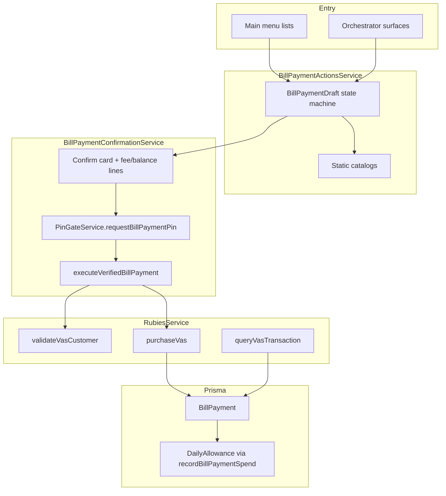

# Bill payments — full implementation (Phase A + B)

**Shipped:** 2026-08-30  
**Spec:** [../specs/BILL_PAYMENTS_SPEC.md](../specs/BILL_PAYMENTS_SPEC.md)  
**API spike:** [BILL_PAYMENTS_SPIKE.md](BILL_PAYMENTS_SPIKE.md)  
**Initiative:** [../../initiatives/bill-payments/plan.md](../../initiatives/bill-payments/plan.md)

This document is the engineer-facing record of everything built from the first airtime purchase through data bundles and prepaid electricity. Use it for onboarding, review, and the planned live walkthrough.

---

## 1. Summary

Amanda can now vend three bill categories from WhatsApp, debiting the same Rubies BaaS wallet used for P2P transfers:

| Category | Entry points | Rubies path |
| --- | --- | --- |
| **Airtime** (Phase A) | Menu **Buy airtime**, orchestrator `bill_payment_wizard` | `baas-vas/purchase` |
| **Data** (Phase B) | Menu **Buy data**, orchestrator `data_bundle_wizard` | `baas-vas/purchase` (fixed bundle price) |
| **Prepaid electricity** (Phase B) | Menu **Pay electricity**, orchestrator `electricity_wizard` | `customerEnquiry` then `baas-vas/purchase` |

Every category follows the same money invariants as transfers:

```
wizard → confirm card → PIN Flow → Rubies execute → allowance recorded
```

There is no PIN bypass, no confirm skip, and no LLM execution of purchases. Amounts and catalog codes come from deterministic surfaces, not model memory.

---

## 2. Architecture



### Module map

| File | Role |
| --- | --- |
| `src/whatsapp/bill-payment.constants.ts` | Airtime telcos, list button prefixes, MSISDN normalize, amount bounds, cancel words |
| `src/whatsapp/bill-payment-catalog.ts` | Curated data bundles + electricity DisCos (prod Rubies codes) |
| `src/whatsapp/bill-payment-actions.service.ts` | Wizards, draft steps, text/list handlers |
| `src/whatsapp/bill-payment-confirmation.service.ts` | Confirm card, PIN handoff, Rubies execute, success/failure copy, token display |
| `src/whatsapp/pin-gate.service.ts` | `requestBillPaymentPin`, `execute_bill_payment` after PIN verify |
| `src/rubies/rubies.service.ts` | `purchaseVas`, `validateVasCustomer`, `queryVasTransaction`, token extraction |
| `src/rubies/rubies-webhook.controller.ts` | Resolve pending VAS by `idempotencyKey`; fetch token on success |
| `src/allowance/allowance.service.ts` | `recordBillPaymentSpend` on EXECUTED |
| `src/whatsapp/whatsapp-router.service.ts` | List buttons + typed wizard intercept |
| `src/whatsapp/account-actions.service.ts` | Main menu rows (7 items, under WhatsApp 10-row cap) |
| `src/orchestrator/surface-registry.ts` | Three wizard surfaces |
| `src/orchestrator/action-executor.service.ts` | Launch wizards; do not cancel bill drafts when switching bill surfaces |

---

## 3. Database

### Migrations

| Migration | Contents |
| --- | --- |
| `20260830120000_bill_payment_airtime` | `BillPaymentDraft`, `BillPayment`, enums, `PinChallenge.billPaymentId` |
| `20260830140000_bill_payment_data_electricity` | `DATA`, `ELECTRICITY` categories; draft steps `AWAITING_PRODUCT`, `AWAITING_METER`, `AWAITING_DISCO`; `productLabel`, `customerName`, `vendorToken` |

### Models

**`BillPaymentDraft`** — in-progress wizard state per user (one ACTIVE at a time).

| Field | Use |
| --- | --- |
| `category` | `AIRTIME` \| `DATA` \| `ELECTRICITY` |
| `step` | Current wizard step (see §4) |
| `billerCode`, `productCode`, `telcoLabel` | Rubies catalog selection |
| `productLabel` | Data bundle display name |
| `customerName` | Verified meter name (electricity) |
| `amount` | User-entered (airtime/electricity) or bundle price (data) |
| `msisdn` | Phone (airtime/data) or meter number (electricity) |

**`BillPayment`** — committed purchase from confirm through execution.

| Field | Use |
| --- | --- |
| `status` | `PENDING_CONFIRMATION` → `PENDING_PIN` → `CONFIRMED` → `EXECUTED` \| `FAILED` \| `CANCELLED` |
| `requestReference` / `idempotencyKey` | `Amanda-BILL-{uuid}` sent to Rubies as `reference` |
| `vendorToken` | Electricity recharge token (shown once to user; not treated as a secret) |
| `feeAmount`, `type` | From `AllowanceService.evaluateSpend` |
| `dailyAllowanceId` | Set when spend is recorded |

---

## 4. User flows

### 4.1 Airtime (Phase A)

1. **Start:** Menu **Buy airtime** or orchestrator launches `bill_payment_wizard`.
2. **Telco:** WhatsApp list — MTN, Airtel, Glo, 9mobile (`telco:{billerCode}`).
3. **Amount:** Free text, ₦50–₦50,000 (`MIN_AIRTIME_AMOUNT` / `MAX_AIRTIME_AMOUNT`).
4. **Phone:** MSISDN normalized to 11-digit local (`070…` / `234…` / 10-digit).
5. **Confirm:** Interactive buttons — amount, optional fee line, balance/allowance preview.
6. **PIN:** WhatsApp PIN Flow via `PinGateService.requestBillPaymentPin`.
7. **Execute:** `RubiesService.purchaseVas` with `billerCustomerId = msisdn`, `productCode` from telco row.
8. **Done:** Category-specific success text; allowance debited on EXECUTED.

### 4.2 Data bundles (Phase B)

1. **Start:** Menu **Buy data** or `data_bundle_wizard`.
2. **Telco:** List `data_telco:{billerCode}` — `MTN_DATA`, `AIRTEL_DATA`, `GLO_DATA`, `9MOBILE_DATA`.
3. **Bundle:** List `bundle:{billerCode}:{productCode}` — up to ~8 curated bundles per network; **amount is catalog `productPrice`, not typed**.
4. **Phone:** Same MSISDN rules as airtime.
5. **Confirm → PIN → execute:** Same as airtime; confirm copy includes bundle label and fixed price.

### 4.3 Prepaid electricity (Phase B)

1. **Start:** Menu **Pay electricity** or `electricity_wizard`.
2. **DisCo:** List `disco:{billerCode}` — 9 major prepaid DisCos (see §5).
3. **Meter:** User types meter number; `normalizeMeterNumber` (10–13 digits).
4. **Verify:** `RubiesService.validateVasCustomer` → `POST /baas-vas/customerEnquiry` with `{ billerCode, productCode, billerCustomerId }`. On failure, user re-enters meter. On success, `customerName` stored on draft.
5. **Amount:** Free text, same ₦50–₦50,000 bounds as airtime unless Rubies catalog dictates otherwise.
6. **Confirm:** Shows verified customer name + meter + DisCo.
7. **PIN → execute:** `purchaseVas` passes verified `customerName` (required for validation billers).
8. **Done:** Success message appends `Token: {vendorToken}` when Rubies returns one.

### Cancel

User may type `cancel`, `stop`, `nevermind` (`BILL_CANCEL_WORDS`) or tap **Cancel** on the confirm card. Draft is cancelled; no money moves.

---

## 5. Static catalogs

Catalogs are **curated and committed in code**, not fetched live on every menu (WhatsApp lists cap at 10 rows; Rubies returns hundreds of products).

### Airtime — `bill-payment.constants.ts`

| Label | billerCode | productCode |
| --- | --- | --- |
| MTN | `MTN_AIRTIME` | `MTN_AIRTIME_PREPAID` |
| Airtel | `AIRTEL_AIRTIME` | `AIRTEL_AIRTIME_PREPAID` |
| Glo | `GLO_AIRTIME` | `GLO_AIRTIME_PREPAID` |
| 9mobile | `9MOBILE_AIRTIME` | `9MOBILE_AIRTIME_PREPAID` |

### Data — `bill-payment-catalog.ts`

Four data billers; bundles keyed by `DATA_BUNDLES_BY_BILLER[billerCode]`. Example MTN entries:

- `MTN_DATA_3.5GB_7D` — ₦1,500
- `MTN_DATA_16.5GB_30D` — ₦6,500

Full list: see source file. Update after a live `getProduct` probe if Rubies retires codes.

### Electricity — `bill-payment-catalog.ts`

| Label | billerCode | productCode |
| --- | --- | --- |
| Ikeja Electric | `IKEDC` | `IKEDC_PREPAID` |
| Eko Electric | `EKEDC` | `EKEDC_PREPAID` |
| Abuja Electric | `AEDC` | `AEDC_PREPAID` |
| Ibadan Electric | `IBEDC` | `IBEDC_PREPAID` |
| Port Harcourt | `PHEDC` | `PHED_PREPAID` |
| Kano Electric | `KEDCO` | `KEDCO_PREPAID` |
| Jos Electric | `JEDC` | `JEDC_PREPAID` |
| Kaduna Electric | `KAEDCO` | `KAEDCO_PREPAID` |
| Enugu Electric | `EEDC` | `ENUGU_PREPAID` |

**Note:** Enugu uses `ENUGU_PREPAID` product code while biller is `EEDC` — confirmed on prod probe.

---

## 6. Rubies BaaS VAS integration

All calls use existing `RUBIES_BASE_URL`, `RUBIES_API_KEY`, and stage prefix (same as wallet/transfers).

| Method | HTTP | Purpose |
| --- | --- | --- |
| `purchaseVas` | `POST /{stage}/baas-vas/purchase` | Debit wallet; body includes `accountNumber`, `billerCustomerId`, `productCode`, `amount`, `reference`, optional `customerName` |
| `validateVasCustomer` | `POST /{stage}/baas-vas/customerEnquiry` | Meter lookup before electricity purchase |
| `queryVasTransaction` | `GET /{stage}/baas-vas/transaction-query/{requestReference}` | Poll pending purchases; webhook fallback |

### Response handling

- `responseCode` mapped to `SUCCESS` \| `PENDING` \| `FAILED` (same helper as transfers).
- `106` / async responses → user sees “processing” copy; webhook or query resolves final state.
- **Token extraction** (`extractVasToken`): checks `vendorToken`, `token`, `rechargeToken`, nested `extraData`.
- **Dry run** (`RUBIES_DRY_RUN=true`): fake success, fake customer name, fake token — safe for local/e2e.

### Idempotency

Each payment gets `requestReference = Amanda-BILL-{uuid}` stored as both `requestReference` and `idempotencyKey`. Rubies webhook matches on this key before calling `queryVasTransaction`.

---

## 7. Router and orchestrator wiring

### List button prefixes

| Prefix | Handler |
| --- | --- |
| `telco:` | Airtime telco selection |
| `data_telco:` | Data network selection |
| `bundle:` | Data bundle selection |
| `disco:` | Electricity DisCo selection |
| `confirm_bill:` | Confirm purchase |
| `cancel_bill:` | Cancel pending payment |

### Menu (`account-actions.service.ts`)

Seven rows: balance, limits, account, transfer, **Buy airtime**, **Buy data**, **Pay electricity** (plus spending menu elsewhere as before).

### Orchestrator surfaces

| Surface key | When model may propose |
| --- | --- |
| `bill_payment_wizard` | User wants airtime now |
| `data_bundle_wizard` | User wants mobile data now |
| `electricity_wizard` | User wants prepaid power / meter token now |

Live facts in `orchestrator.service.ts` expose active bill draft category and pending confirm/PIN state so the model does not invent balances or re-launch wizards mid-flow.

### Executor

`BILL_PAYMENT_SURFACES` set prevents cancelling an in-progress bill draft when switching between the three bill wizards.

---

## 8. Security invariants (unchanged)

| Invariant | Bill pay behavior |
| --- | --- |
| S7 PIN before money | PIN Flow required; `executeVerifiedBillPayment` only after verify |
| S8 Validator on every turn | Orchestrator only launches surfaces; never executes purchase |
| Surfaces own numbers | Amounts from catalog or re-read from DB at confirm/execute |
| No bypass flags | No `skipPin`, `forceSend`, or debug money routes |
| Redaction | PIN never logged; tokens **are** shown to user (product requirement) |

Run `npm run security:check` before merge.

---

## 9. Probe scripts (ops / catalog refresh)

Read-only and smoke scripts under `scripts/` (not in request path):

| Script | Purpose |
| --- | --- |
| `rubies-vas-smoke.mjs` | Basic VAS connectivity |
| `rubies-vas-purchase-smoke.mjs` | Live purchase smoke (use tiny amounts) |
| `rubies-vas-phase-b-probe.mjs` | DATA_BUNDLE + ELECTRICITY catalog + customerEnquiry |
| `rubies-vas-openapi-paths.mjs` | OpenAPI path listing (reference only) |
| `rubies-vas-list-txs*.mjs`, `*-diagnose*.mjs` | Transaction query debugging |

Re-run Phase B probe before changing curated catalogs.

---

## 10. Tests

| Area | Files / commands |
| --- | --- |
| Catalog helpers | `bill-payment-catalog.spec.ts` |
| Confirm copy + token | `bill-payment-confirmation.service.spec.ts` |
| Rubies VAS dry-run | `rubies.service.spec.ts` |
| Menu rows | `account-actions.service.spec.ts` |
| Executor surfaces | `action-executor.service.spec.ts` |
| Router handlers | `whatsapp-router.service.spec.ts` |
| Orchestrator regression | `npm run orchestrator:golden` (47 cases) |
| Docs links | `npm run docs:check` |
| Security gate | `npm run security:check` |

Targeted Jest example:

```bash
npx jest src/whatsapp/bill-payment-catalog.spec.ts src/whatsapp/bill-payment-confirmation.service.spec.ts src/rubies/rubies.service.spec.ts --no-coverage
```

---

## 11. Local setup

1. Postgres on `:5433` (see `docs/DEVELOPMENT.md`).
2. `npx prisma migrate deploy`
3. `.env`: `WHATSAPP_DRY_RUN=true`, `RUBIES_DRY_RUN=true`, `AI_PROVIDER=stub` for safe local runs.
4. Exercise flows via WhatsApp test number or router unit tests.

---

## 12. Live walkthrough checklist (post-merge)

Not done in implementation PR — run manually with user-approved values:

- [ ] Airtime: small amount (e.g. ₦100), known test MSISDN
- [ ] Data: one bundle from curated list, test MSISDN
- [ ] Electricity: test prepaid meter, small amount, capture token in success message
- [ ] Confirm allowance + wallet balance reflect debits
- [ ] If Rubies returns PENDING, confirm webhook/query resolves

---

## 13. Out of scope (Phase C+)

- Cable TV, transport, other VAS categories
- Recurring / scheduled bill pay
- Separate Rubies Open API client (`openapi.rubiesbank.io`)
- Live 376-product catalog in WhatsApp lists

---

## Changelog

| Date | Change |
| --- | --- |
| 2026-08-30 | Initial full implementation doc (Phase A airtime + Phase B data/electricity) |
